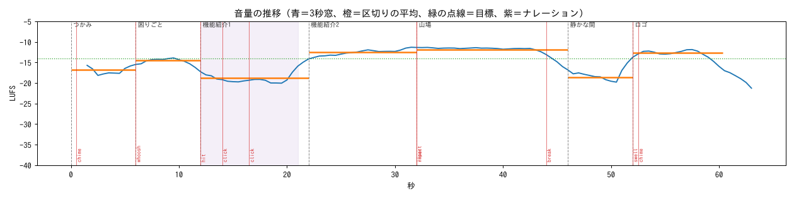
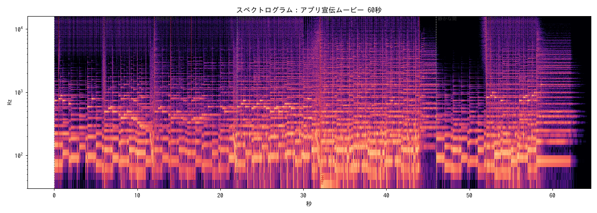
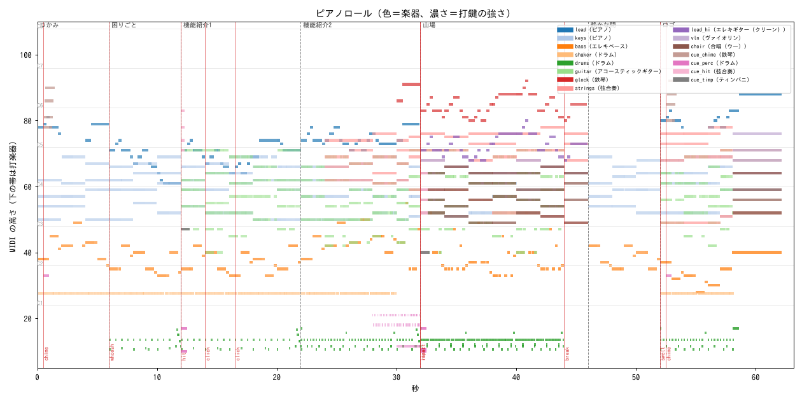
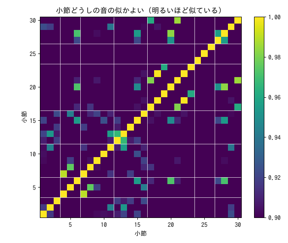

# 確かめの報告：アプリ宣伝ムービー 60秒

- 様式：明るいポップ（bright_pop）　テンポ 120　拍子 4/4　調 D major　長さ 60.3 秒
- 音源：GeneralUser-GS.sf2（fluidsynth）
- ラウドネス -13.92 LUFS（目標 -14）／真のピーク -1.05 dBTP（天井 -1）

## 直したほうがよさそうな所

- なし

## 区切りごと

| 区切り | 秒 | 勢い | LUFS | 音/秒 | 明るさ(Hz) | 広がり | 調 | 足した楽器 | 抜いた楽器 |
|---|---|---|---|---|---|---|---|---|---|
| つかみ（intro） | 0.0–6.0 | 0.35 | -16.7 | 15.2 | 3448 | 0.164 | D major | - | - |
| 困りごと（verse） | 6.0–12.0 | 0.40 | -14.4 | 20.5 | 2827 | 0.161 | D major | drums | - |
| 機能紹介1（verse） | 12.0–22.0 | 0.50 | -18.7 | 34.6 | 2880 | 0.198 | D major | guitar | - |
| 機能紹介2（build） | 22.0–32.0 | 0.68 | -12.5 | 43.6 | 3240 | 0.206 | D major | glock, strings | - |
| 山場（chorus） | 32.0–46.0 | 0.92 | -11.9 | 41.9 | 2924 | 0.266 | E major | choir, lead_hi, vln | lead, shaker |
| 静かな間（break） | 46.0–52.0 | 0.30 | -18.6 | 6.0 | 3108 | 0.115 | E major | - | choir, drums, glock, guitar, lead_hi, strings, vln |
| ロゴ（outro） | 52.0–60.3 | 0.70 | -12.7 | 34.5 | 3210 | 0.212 | E major | choir, drums, guitar, lead, shaker, strings, vln | - |

帯域のバランス（エネルギーの割合）：低音 〜120Hz 31.6%、中低 120〜500 42.5%、中 500〜2k 22.4%、中高 2k〜6k 2.8%、高 6k〜 0.7%

## 音域

| 楽器 | 役 | 最低 | 中央 | 最高 | 音の数 | 音域の外 |
|---|---|---|---|---|---|---|
| ピアノ（lead） | melody | C#4 | D5 | E6 | 75 | 0 |
| ピアノ（keys） | comp | D3 | C#4 | A4 | 424 | 0 |
| エレキベース（bass） | bass | E1 | D2 | G3 | 141 | 0 |
| アコースティックギター（guitar） | comp | E2 | A3 | B4 | 486 | 0 |
| 鉄琴（glock） | double | G#5 | C6 | G#6 | 34 | 0 |
| 弦合奏（strings） | pad | C#3 | A4 | F#5 | 68 | 0 |
| エレキギター（クリーン）（lead_hi） | melody | G#4 | B4 | G#5 | 32 | 0 |
| ヴァイオリン（vln） | counter | E4 | F#4 | E5 | 11 | 0 |
| 合唱（ウー）（choir） | pad | C#3 | A#3 | F#4 | 32 | 0 |
| 鉄琴（cue_chime） | cue | F#5 | C#6 | G#6 | 8 | 0 |
| 弦合奏（cue_hit） | cue | E2 | C#4 | B5 | 10 | 0 |
| ティンパニ（cue_timp） | cue | E2 | G2 | B2 | 2 | 0 |

## 和音

設計した和音の種類 12。MIDI から推定した和音との一致 100%、書き出した音から推定した和音との一致 97%（音からの推定は根音が合えば一致とみなす）。

| 秒 | 区切り | 設計 | 記号 | MIDI | 音 |
|---|---|---|---|---|---|
| 0.0 | つかみ | D | I | D | D |
| 2.0 | つかみ | F#m | iii | F#m | F#m |
| 4.0 | つかみ | G | IV | G | G |
| 6.0 | 困りごと | Bm | vi | Bm | Bm |
| 8.0 | 困りごと | Em | ii | Em | Em |
| 10.0 | 困りごと | A | V | A | Asus4 |
| 12.0 | 機能紹介1 | Bm | vi | Bm | Bm |
| 14.0 | 機能紹介1 | Em | ii | Em | Em |
| 16.0 | 機能紹介1 | A | V | A | A7 |
| 18.0 | 機能紹介1 | D | I | D | D |
| 20.0 | 機能紹介1 | Bm | vi | Bm | Bm |
| 22.0 | 機能紹介2 | D | I | D | D |
| 24.0 | 機能紹介2 | D/F# | I/3 | Dmaj7 | F#m7 ✗ |
| 26.0 | 機能紹介2 | G | IV | G | G |
| 28.0 | 機能紹介2 | A | V | A | Amaj7 |
| 30.0 | 機能紹介2 | G | IV | G | G |
| 31.0 | 機能紹介2 | B7 | V7 | B7 | B7 |
| 32.0 | 山場 | E | I | E | E |
| 34.0 | 山場 | B | V | B | B |
| 36.0 | 山場 | C#m | vi | C#m | C#m |
| 38.0 | 山場 | A | IV | A | Amaj7 |
| 40.0 | 山場 | E | I | E | E |
| 42.0 | 山場 | B | V | B | B |
| 44.0 | 山場 | C#m | vi | C#m | C#m7 |
| 46.0 | 静かな間 | F#m | ii | F#m | F#m |
| 48.0 | 静かな間 | B | V | B | B |
| 50.0 | 静かな間 | E | I | E7 | E |
| 52.0 | ロゴ | C#m | vi | C#m | C#m |
| 54.0 | ロゴ | A | IV | A | Amaj7 |
| 56.0 | ロゴ | F#m7 | ii7 | F#m7 | F#m7 |
| 57.0 | ロゴ | B7 | V7 | B7 | B7 |
| 58.0 | ロゴ | E | I | E | E |

## 同じ小節の繰り返し

全 30 小節のうち、中身の違う小節 30。全楽器が同じ小節の組 0、そのうち連続 0。音の特徴がほぼ同じ（0.998 超）の組 1。

## クリップ

最大値に張りついたサンプル 0、サンプルのピーク -1.28 dBFS、真のピーク -1.05 dBTP。

## 機械っぽさの目安

- 音色の系統 7 種類：bass, bowed, choir, drums, keys, mallet, pluck
- 打鍵の強さのばらつき（標準偏差）：lead 7.9、keys 10.8、bass 11.1、shaker 9.9、drums 14.5、guitar 12.8、glock 4.4、strings 6.5、lead_hi 3.8、vln 9.0、choir 4.4
- 拍の格子からのずれ（標準偏差 ms）：lead 5.7、keys 13.7、bass 5.3、shaker 3.5、drums 12.1、guitar 17.1、glock 6.1、strings 3.8、lead_hi 5.4、vln 4.1、choir 2.8
- 左右の相関 0.778（1 に近いほどモノラル）、最後の音のあとの響き -12.6 dB、スペクトルの時間変化 0.761
- 判定：目安の範囲では機械的な所は見つからない

## 弾き方の目安

| 楽器 | 役 | 強さ 平均／最大 | 音のあいだが空く割合 | ペダル | ベースの同音連打 |
|---|---|---|---|---|---|
| lead | melody | 74.9／89 | 0% | 32 | - |
| keys | comp | 64.8／88 | - | 32 | - |
| bass | bass | 72.9／92 | - | - | 3 |
| guitar | comp | 58.7／88 | - | - | - |
| glock | double | 68.2／78 | 0% | - | - |
| strings | pad | 70.5／82 | - | - | - |
| lead_hi | melody | 87.4／95 | 0% | - | - |
| vln | counter | 93.1／104 | 0% | - | - |
| choir | pad | 75.2／86 | - | - | - |

2.5kHz 以上の割合 2.7%（目安 5% 以下）。判定：目安の範囲

## きっかけ

| 秒 | 種類 | 効き | メモ |
|---|---|---|---|
| 0.50 | chime | 立ち上がり 2.45（周りの拍頭=1、ずれ -9ms） | アプリのアイコンが出る |
| 6.00 | whoosh | 立ち上がり 1.48（周りの拍頭=1、ずれ +16ms） | 画面が横に流れる |
| 12.00 | hit | 立ち上がり 2.03（周りの拍頭=1、ずれ +11ms） | 機能紹介のタイトル |
| 14.00 | click | 立ち上がり 3.41（周りの拍頭=1、ずれ -5ms） | ボタンを押す |
| 16.50 | click | 立ち上がり 1.52（周りの拍頭=1、ずれ +12ms） | 2回目のタップ |
| 32.00 | riser | 高域 +6.8 dB の上昇 | 山場への溜め（28〜32秒、at は溜めの終わり） |
| 32.00 | impact | 立ち上がり 1.83（周りの拍頭=1、ずれ +0ms） | 山場の頭 |
| 44.00 | break | -6.7 dB | 拍を落とす（44〜46秒） |
| 52.00 | swell | 高域 +25.7 dB の上昇 | ロゴへ |
| 52.50 | chime | 立ち上がり 3.19（周りの拍頭=1、ずれ +1ms） | ロゴが光る |

## 作曲の判断の記録

- つかみ（intro・bright）：和声 I iii IV V  調 D major
- 困りごと（verse・tense）：和声 vi ii V I  調 D major
- 機能紹介1（verse・bright）：和声 vi ii V I  調 D major
- 機能紹介2（build・bright）：和声 I I/3 IV V  調 D major
- 機能紹介2：終止 half（IV V）
- 機能紹介2→山場：D major から E major へ、属七で橋渡しして転調
- 山場（chorus・epic）：和声 I V vi IV  調 E major
- 静かな間（break・calm）：和声 ii V I vi  調 E major
- ロゴ（outro・epic）：和声 vi IV I V  調 E major
- ロゴ：終止 authentic（ii7 V7 I）
- つかみ：編成 ピアノ（melody）、ピアノ（comp）、エレキベース（bass）、ドラム（perc）
- 困りごと：編成 ピアノ（melody）、ピアノ（comp）、エレキベース（bass）、ドラム（drums）、ドラム（perc）
- 機能紹介1：編成 ピアノ（melody）、ピアノ（comp）、アコースティックギター（comp）、エレキベース（bass）、ドラム（drums）、ドラム（perc）
- 機能紹介2：編成 ピアノ（melody）、鉄琴（double）、ヴァイオリン（counter）、弦合奏（pad）、ピアノ（comp）、アコースティックギター（comp）、エレキベース（bass）、ドラム（drums）、ドラム（perc）
- 山場：編成 エレキギター（クリーン）（melody）、鉄琴（double）、ヴァイオリン（counter）、弦合奏（pad）、合唱（ウー）（pad）、ピアノ（comp）、アコースティックギター（comp）、エレキベース（bass）、ドラム（drums）
- 静かな間：編成 ピアノ（melody）、ピアノ（comp）、エレキベース（bass）
- ロゴ：編成 ピアノ（melody）、弦合奏（pad）、ピアノ（comp）、アコースティックギター（comp）、エレキベース（bass）、ドラム（drums）、ドラム（perc）
- 動機A：リズム [0, 1, 1.5, 2, 3.5] 音の動き [0, 1, 2, 0, -1]
- きっかけ chime @ 0.50秒（つかみ）アプリのアイコンが出る
- きっかけ whoosh @ 6.00秒（困りごと）画面が横に流れる
- きっかけ hit @ 12.00秒（機能紹介1）機能紹介のタイトル
- きっかけ click @ 14.00秒（機能紹介1）ボタンを押す
- きっかけ click @ 16.50秒（機能紹介1）2回目のタップ
- きっかけ riser @ 32.00秒（山場）山場への溜め（28〜32秒、at は溜めの終わり）
- きっかけ impact @ 32.00秒（山場）山場の頭
- きっかけ break @ 44.00秒（山場）拍を落とす（44〜46秒）
- きっかけ swell @ 52.00秒（ロゴ）ロゴへ
- きっかけ chime @ 52.50秒（ロゴ）ロゴが光る
- 同じ小節の解消：0 か所を変えた
